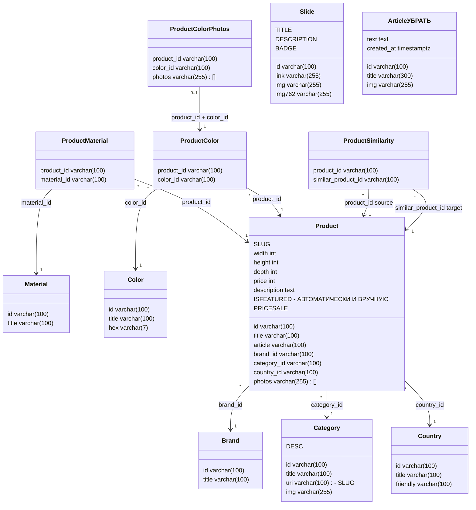
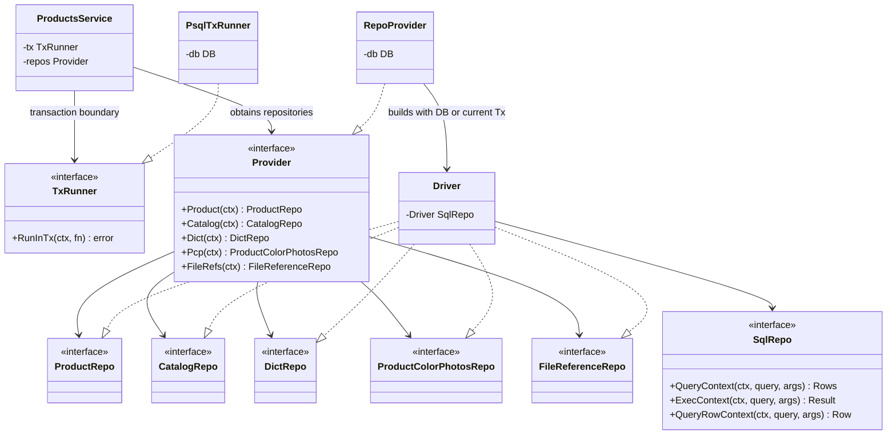

# Условная диаграмма классов Volha Backend

Модель составлена по миграции [`000001_init.up.sql`](../build/volha/migrations/000001_init.up.sql) и сверена с доменными структурами в `internal/product-service/domain`. Это схема текущего каталога и контента, а не будущих сервисов из дорожной карты.

## Реляционная модель

Поля в диаграмме показывают SQL-столбцы и их типы. Первичные и внешние ключи, ограничения и каскады описаны ниже.

# Экраны
- Главная - слайдер, подписка на новости
- Каталог - id, slug, категория, название, цена, картинка, скидка, хит 
- Продукт + корзина 
- О нас - фронт
- DIY - привязанные товары 
- Контакты - фронт
- Корзина
- Все DIY - id, тип, сложность, картинка, название, описание, ссылка на пдф, срок, слаг
- Админка

### обьединить репозитории

`ProductMaterial`, `ProductColor`, `ProductSimilarity` и `ProductColorPhotos` — реальные таблицы-связки/зависимые таблицы, а не отдельные пользовательские сущности. `Slide` и `Article` хранятся независимо от товарного каталога: у них нет внешних ключей.

## Поля и ограничения таблиц

Во всех таблицах `id` — первичный ключ, кроме таблиц связей, где составной PK указан явно. Если поле помечено `NOT NULL`, оно обязательно.

| Таблица | Атрибуты и ограничения |
|---|---|
| `brands` (`Brand`) | `id varchar(100)` PK; `title varchar(100)` NOT NULL, UNIQUE. |
| `categories` (`Category`) | `id varchar(100)` PK; `title varchar(100)` NOT NULL; `uri varchar(100)` NOT NULL, UNIQUE; `img varchar(255)` NOT NULL, DEFAULT `''`. |
| `countries` (`Country`) | `id varchar(100)` PK; `title varchar(100)` NOT NULL; `friendly varchar(100)` NOT NULL, DEFAULT `''`. |
| `materials` (`Material`) | `id varchar(100)` PK; `title varchar(100)` NOT NULL, UNIQUE. |
| `colors` (`Color`) | `id varchar(100)` PK; `title varchar(100)` NOT NULL, UNIQUE; `hex varchar(7)` NOT NULL. |
| `products` (`Product`) | `id varchar(100)` PK; `title varchar(100)` NOT NULL, UNIQUE; `article varchar(100)` NOT NULL, UNIQUE; `brand_id`, `category_id`, `country_id varchar(100)` NOT NULL и FK на соответствующие справочники; `width`, `height`, `depth int` NOT NULL и `> 0`; `photos varchar(255)[]` NOT NULL, DEFAULT пустой массив; `price int` NOT NULL и `> 0`; `description text` NOT NULL, DEFAULT `''`. |
| `product_materials` (`ProductMaterial`) | `product_id`, `material_id varchar(100)` NOT NULL; PK (`product_id`, `material_id`); оба поля FK. Удаление продукта каскадно удаляет строки связей. |
| `product_colors` (`ProductColor`) | `product_id`, `color_id varchar(100)` NOT NULL; PK (`product_id`, `color_id`); оба поля FK. Удаление продукта каскадно удаляет строки связей. |
| `product_similarities` (`ProductSimilarity`) | `product_id`, `similar_product_id varchar(100)` NOT NULL; PK из обоих полей; оба поля ссылаются на `products(id)` с `ON DELETE CASCADE`; CHECK запрещает ссылку товара на самого себя. |
| `product_color_photos` (`ProductColorPhotos`) | `product_id`, `color_id varchar(100)` NOT NULL; `photos varchar(255)[]` NOT NULL, DEFAULT пустой массив; PK (`product_id`, `color_id`); составной FK на `product_colors(product_id, color_id)` с `ON DELETE CASCADE`. Фотографии возможны только для цвета, назначенного товару. |
| `slides` (`Slide`) | `id varchar(100)` PK; `link`, `img`, `img762 varchar(255)` NOT NULL. |
| `articles` (`Article`) | `id varchar(100)` PK; `title varchar(300)` NOT NULL; `img varchar(255)` NOT NULL; `text text` NOT NULL, DEFAULT `''`; `created_at timestamptz` NOT NULL, DEFAULT `now()`. |

Непомеченные как каскадные внешние ключи используют стандартное поведение PostgreSQL (`NO ACTION`): справочник нельзя удалить, пока на него ссылаются строки. Для пары в `product_similarities` уникальность направленная: `(A, B)` и `(B, A)` могут существовать отдельно; взаимность не гарантируется.

## Кратности связей

- Один `Brand`, `Category` или `Country` может относиться к нулю или многим `Product`; каждый товар обязан иметь ровно один элемент каждого из этих справочников.
- `Product` и `Material` связаны многие-ко-многим через `ProductMaterial`; `Product` и `Color` — многие-ко-многим через `ProductColor`.
- Самоссылка товара «похожие товары» реализована направленной таблицей `ProductSimilarity`: один товар может иметь много рекомендаций и быть рекомендован многими товарами.
- `ProductColorPhotos` зависит от конкретной пары `ProductColor`: для назначенной товару окраски хранится одна строка с массивом фотографий; пара `(product_id, color_id)` уникальна.
- `Slide` и `Article` независимы от перечисленных классов по внешним ключам.

В миграции также заданы индексы: `products(brand_id)`, `products(category_id)`, `products(country_id)`, `products(price)`, `product_materials(material_id, product_id)`, `product_colors(color_id, product_id)`, `product_similarities(similar_product_id, product_id)`. Первичные ключи и UNIQUE-ограничения дополнительно создают соответствующие уникальные индексы.

## Доменные структуры и DTO

Go-модели имеют немного другую форму, чем строки SQL: `Product` содержит вложенные объекты справочников и списки связанных сущностей; внешние ID и таблицы связей разворачиваются репозиториями. Ниже приведены поля структур из `internal/product-service/domain`.

| Структура | Атрибуты Go |
|---|---|
| `Product` | `Id string`, `Title string`, `Article string`, `Brand *Brand`, `Category *Category`, `Country *Country`, `Width int32`, `Height int32`, `Depth int32`, `Materials []*Material`, `Colors []*Color`, `Photos []string`, `Seems []*Product`, `Price int32`, `Description string`. `Seems` — модельное представление исходящих рекомендаций `product_similarities`. |
| `ProductId` | `Id string`, `Title string`, `Article string`, `Brand string`, `Category string`, `Country string`, `Width int32`, `Height int32`, `Depth int32`, `Materials []string`, `Colors []string`, `Photos []string`, `Seems []string`, `Price int32`, `Description string`. Входная/командная форма товара с ID справочников для записи. |
| `ProductFilter` | `Brand []string`, `Country []string`, `Category []string`, `MinWidth int32`, `MaxWidth int32`, `MinHeight int32`, `MaxHeight int32`, `MinDepth int32`, `MaxDepth int32`, `Materials []string`, `Colors []string`, `MinPrice int32`, `MaxPrice int32`, `SortBy string`, `SortOrder string`, `Offset int32`, `Limit int32`, `Title string`. DTO фильтрации, отдельной таблицы нет. |
| `Dictionaries` | `Brands []*Brand`, `Categories []*Category`, `Countries []*Country`, `Materials []*Material`, `Colors []*Color`, `MinPrice int32`, `MaxPrice int32`, `MinWidth int32`, `MaxWidth int32`, `MinHeight int32`, `MaxHeight int32`, `MinDepth int32`, `MaxDepth int32`. Вычисляемая выборка справочников и границ фильтра; отдельной таблицы нет. |
| `ProductColorPhotos` | `ProductId string`, `ColorId string`, `Photos []string`; соответствует строке `product_color_photos`. |
| `Brand` | `Id string`, `Title string`; соответствует `brands`. |
| `Category` | `Id string`, `Title string`, `Uri string`, `Img string`; соответствует `categories`. |
| `Country` | `Id string`, `Title string`, `Friendly string`; соответствует `countries`. |
| `Material` | `Id string`, `Title string`; соответствует `materials`. |
| `Color` | `Id string`, `Title string`, `Hex string`; соответствует `colors`. |
| `Slide` | `Id string`, `Link string`, `Img string`, `Img762 string`; соответствует `slides`. |
| `Article` | `Id string`, `Title string`, `Img string`, `Text string`, `CreationTime int64`; `CreationTime` — Unix-время из `articles.created_at`. |

## Зависимости слоёв приложения

Диаграмма показывает зависимости продуктового сервиса и репозитория, относящиеся к работе с данными. `Driver` реализует интерфейсы репозиториев, а `RepoProvider` выбирает соединение или транзакцию из контекста. PostgreSQL-модели выше — схема данных, отдельные классы сетевого gateway в эту модель не включены.

`ProductRepo` работает с товарами; `CatalogRepo` — со справочниками, слайдами и статьями; `DictRepo` собирает `Dictionaries`; `ProductColorPhotosRepo` читает и меняет фотографии расцветок; `FileReferenceRepo` проверяет, используется ли имя файла в категориях, товарах, фото расцветок, слайдах или статьях. `ProductFilter`, `ProductId` и доменные сущности передаются между service и repository, а SQL-запросы принадлежат repository.

## Источники

- `build/volha/migrations/000001_init.up.sql` — таблицы, колонки, ключи, проверки и индексы.
- `internal/product-service/domain/*.go` — модели приложения и DTO.
- `internal/product-service/repository/*.go` — интерфейсы репозиториев, SQL-сборка моделей.
- `internal/product-service/service/service.go`, `service/tx.go`, `infra/psql/psqltx/*.go` — границы зависимостей и транзакций.
